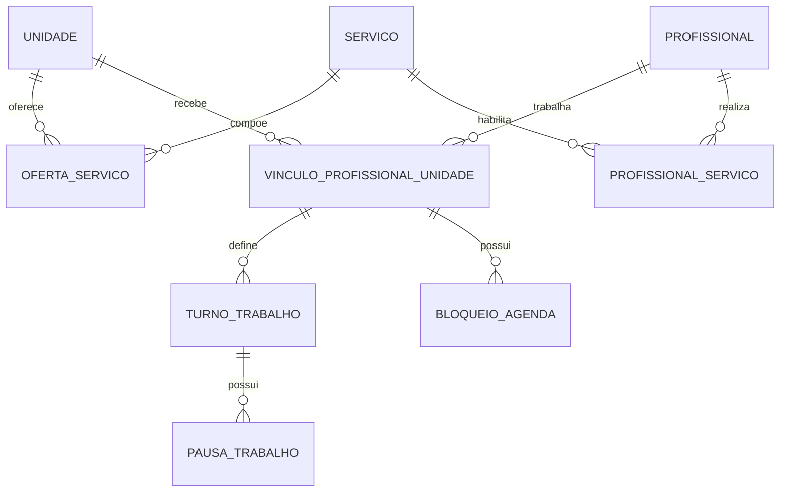

# Modelagem do banco BarberCom

Esta primeira parte documenta o banco das quatro telas administrativas do Figma e prepara os dados do login. O banco escolhido é PostgreSQL, já disponível no computador. Não representa o sistema inteiro.

## Tabelas e campos

Todos os campos são obrigatórios, exceto `foto_url` e os horários do bloqueio. `id` é um número gerado pelo banco e identifica um registro. Campos terminados em `_id` apontam para registros de outras tabelas.

| Tabela | Campos | Para que serve |
| --- | --- | --- |
| usuario | id, nome, telefone, senha_hash, perfil, ativo | Dados do acesso; perfil GESTOR ou CLIENTE. |
| unidade | id, nome, endereco, ativa | Cadastro das unidades. |
| profissional | id, nome, foto_url, ativo | Cadastro dos profissionais; a foto é uma referência, não o arquivo em si. |
| servico | id, nome, ativo | Catálogo de serviços. |
| oferta_servico | id, unidade_id, servico_id, preco, duracao_minutos, ativa | Preço e duração do serviço em cada unidade. |
| vinculo_profissional_unidade | id, profissional_id, unidade_id, ativo | Unidades em que um profissional trabalha. |
| profissional_servico | profissional_id, servico_id | Serviços que o profissional sabe realizar; os dois campos juntos identificam o vínculo. |
| turno_trabalho | id, vinculo_id, dia_semana, hora_inicio, hora_fim | Jornada semanal em uma unidade; segunda = 1 e domingo = 7. |
| pausa_trabalho | id, turno_id, descricao, hora_inicio, hora_fim | Pausa que se repete no dia e turno associados. |
| bloqueio_agenda | id, vinculo_id, data, descricao, tipo, hora_inicio, hora_fim | Feriado ou indisponibilidade em uma data. Sem horários significa dia inteiro. |

Exemplo: o serviço Corte existe uma vez em `servico`. Em `oferta_servico`, pode custar R$ 35 na unidade Barra e R$ 40 em outra unidade, sem duplicar o cadastro do serviço.

## Relacionamentos

`usuario` não se liga ao profissional nesta etapa: a pessoa cadastrada para atender não ganha automaticamente uma conta de acesso.

## Regras que o SQL já verifica

- Nomes, endereços e descrições obrigatórios não podem ficar em branco.
- Telefone é único e deve conter apenas de 10 a 15 dígitos, incluindo DDD; a aplicação removerá a formatação antes de salvar.
- Preços usam decimal, sem arredondamento de ponto flutuante, e não podem ser negativos.
- Duração precisa ser maior que zero; o dia da semana vai de 1 a 7.
- O fim de um intervalo deve ser posterior ao início.
- Um bloqueio tem os dois horários preenchidos ou nenhum deles.
- Um mesmo profissional não tem dois vínculos com a mesma unidade; uma oferta não repete o mesmo par unidade/serviço.
- Não é possível referenciar uma unidade, serviço, profissional, vínculo ou turno inexistente.
- Excluir um registro referenciado é impedido pelo banco. As telas de cadastro usarão inativação para preservar os vínculos.

Senha: o campo `senha_hash` é apenas armazenamento. A aplicação ainda deverá gerar e verificar um hash seguro; o banco não transforma uma senha em hash e esta etapa não implementa autenticação.

## Regras da próxima etapa

O backend ainda precisará verificar permissões, dados ativos, pausas dentro do turno e sobreposições de turnos do mesmo profissional, inclusive entre unidades. Essas regras atravessam registros e não estão implementadas nesta entrega. A validação deverá impedir conflitos também quando houver duas gravações simultâneas.

A habilitação por serviço é global ao profissional. Para atender, ele também deverá estar vinculado à unidade e o serviço deverá ter oferta ativa nela. Isso simplifica o rascunho de classes, que prevê habilitação por oferta; se a equipe exigir restrição específica por unidade, ajustaremos esse vínculo antes de implementar a tela.

Os intervalos desta versão ficam no mesmo dia; um turno das 22h às 2h precisa ser dividido entre os dois dias.

## Escopo e fontes

As quatro telas correspondem às páginas de gerenciamento de unidades, profissionais, horários e serviços da documentação `Documentacao_de_telas_e_funcionalidades_-_novo_assinado_assinado.pdf`, páginas 9 a 12, e à página `Telas · Admin` do Figma Barber Com.

O documento `Critérios de Aceitação-Robert.docx` orienta cadastro, edição, inativação e manutenção de horários. O `Draft2_Diagrama de Classes.drawio` orienta os nomes e relacionamentos, com a simplificação de habilitação explicada acima. São fontes de requisitos, não instruções para executar ações no computador.

Este documento começou com as quatro telas selecionadas. As migrações 002 a 004 acrescentaram identidade Google em usuario, sessões em sessao, reservas em agendamento e itens de preço/duração preservados em item_agendamento. Histórico e disponibilidade usam essas tabelas. SMS foi retirado por decisão do responsável; verificacao_telefone é uma tabela legada preservada, sem uso pelo cadastro atual. Clientes são cadastrados diretamente com senha em hash e perfil CLIENTE.

## Complementos — migração 005

unidade recebe latitude/longitude opcionais com limites e preenchimento em par. foto_profissional armazena um JPEG por profissional, relacionado por profissional_id; a foto faz parte do backup do PostgreSQL. agendamento recebe origem (AGENDAMENTO/AVULSO); avulsos já entram CONCLUIDO. item_agendamento recebe profissional_id para registrar o responsável de cada serviço/adicional; a migração atribui o profissional original aos itens antigos. As alterações são aditivas e reaplicáveis.

As unidades de demonstração estão em database/unidades-demonstracao.json, com coordenadas fictícias aproximadas e endereços marcados como fictícios. Referências de vias, sem verificação de imóveis: [Rua Caetano Moura na Federação](https://www.cms.ba.gov.br/noticias/08-10-2025-audiencia-publica-debate-demandas-estruturais-da-rua-caetano-moura-na-federacao) e [logradouro de Salvador, incluindo Campo da Pólvora/Joana Angélica](https://servicosweb.sefaz.salvador.ba.gov.br/sistema/legislacao/decretos/Dec16302Alt20188-Anexo.pdf). Os pontos não indicam barbearias reais.
